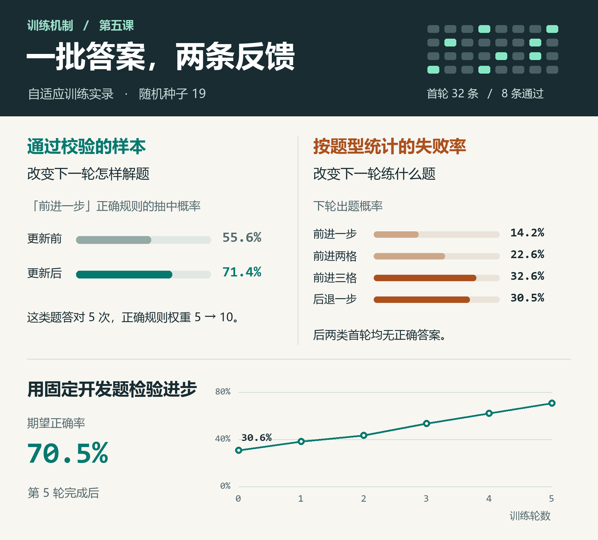

# Recursive Self-Improvement: From Feedback Loops to Model Evaluation

[简体中文](README.md) · **English**

Build a policy that learns from verified answers, then apply the same evaluation discipline to a support-ticket router. The six notebooks run on a CPU. Four engineering lessons take you from a routing specification to a decision about testing a candidate alongside the existing system. This guide is in English. The linked lessons, ticket data, and routing labels are in Chinese.

## Run the first notebook

Open a terminal in the repository root. With Python 3.10 or newer, run:

```sh
python -m pip install jupyterlab ipykernel
python -m ipykernel install --user --name rsi-course --display-name "Python (RSI)"
python -m jupyterlab 01_环境与第一次运行.ipynb
```

Select **Python (RSI)** in JupyterLab and press **Shift + Enter** to run each cell. In the first exercise, moving three places from 8 wraps around to 1. Open `results/first_run.txt` to check the saved answer. If the browser does not open, copy the local URL from the terminal. You can also browse the [course index](课程首页.ipynb).

## How the feedback loop works



In lesson 5, the probability of choosing the correct rule for “move forward one” rises from **55.6% to 71.4%** after five verified answers. The policy gets every “move forward three” example wrong in round one, so the adaptive sampler allocates **32.6%** of the next round to that task. Across five rounds, expected accuracy on the fixed development set rises from **30.6% to 70.5%**. Reproduce the figure with seed 19 and 32 samples per round. These numbers describe the four-rule arithmetic task.

## Notebook labs

Allow about 3 hours and 20 minutes including exercises. Each notebook can start in a fresh kernel.

| Lesson | What you will check |
|---|---|
| [1 · Setup and first run](01_环境与第一次运行.ipynb) | Calculate an answer, save it, and read it back. |
| [2 · Policies and sampling](02_策略与采样概率.ipynb) | Increase one rule’s weight by 10 and compare its predicted probability with 1,000 draws. |
| [3 · Verification and data splits](03_校验器与数据划分.ipynb) | Reject a wrong answer and check that the training, development, and test inputs are disjoint. |
| [4 · Trace one training round](04_追踪一轮训练.ipynb) | Account for every weight change in a batch of 16 samples. |
| [5 · Recursive feedback and fair comparisons](05_递归反馈与公平对照.ipynb) | Compare three training schedules using 160 samples each and a common frozen baseline. |
| [6 · Failure analysis and final report](06_失败诊断与毕业报告.ipynb) | Reproduce an exploration failure and a faulty reward, then inspect the 12 runs in the report. |

Change one parameter at a time and rerun the notebook from the beginning. Lesson 6 writes `results/final_report.json` again on each run. Copy the file first to keep both results.

## Engineering practicum

Allow another 4–5 hours plus the independent assignment. Run `python practicum/run.py --help` from the repository root. The offline project uses the Python standard library and synthetic Chinese tickets. A routing prediction must be one of three labels: 账单 (billing), 账户 (account access), or 物流 (delivery).

| Lesson | What you will deliver |
|---|---|
| [7 · Take ownership of a routing task](practicum/07_接手第一张工单.md) | A task brief, a labeling contract, and checks for split leakage. |
| [8 · Develop and freeze a candidate](practicum/08_从基线到候选版本.md) | A reproducible candidate and a comparison with training on all reviewed labels. |
| [9 · Connect a local language model](practicum/09_接入本地语言模型.md) | A single-request trace and a diagnosis of formatting and latency issues. Running the model branch requires a local Ollama service. |
| [10 · Review and hand off](practicum/10_发布评审与交接.md) | A paired evaluation, a failure analysis, and a decision to hold the candidate or run it in shadow mode. |

In shadow mode, the baseline still handles requests while the candidate’s predictions are recorded for comparison. For the final assignment, choose three request types from your own field and ask a colleague to reproduce your decision from a clean checkout.

## Troubleshooting

- **Cannot import `rsi_lab`** — Start Jupyter from the repository root. The working directory printed in lesson 1 should contain `rsi_lab.py`.
- **Undefined variable** — Select **Kernel → Restart Kernel and Run All Cells** to restore the notebook’s state.
- **Missing report** — Check the absolute path printed by the save cell and refresh the file browser.
- **Editing a lesson** — The [experiment module](rsi_lab.py) contains the shared training logic. Edit the [notebook generator](build_course.py) and run `python build_course.py` to rebuild the six notebooks. Save your own notebook notes before rebuilding.
