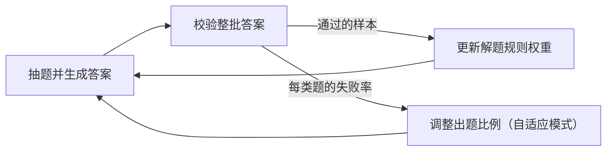

# 递归自我改进：从原理到工程实战

  

**工作目标**：独立接手一张模型改进工单，从定义验收标准、复现基线、筛选反馈数据，到冻结候选、评估回退并向团队交接。前六课用小实验讲机制，后四课把同一套方法迁移到客服工单路由。核心路线使用 CPU 和合成中文工单，第 9 课另有本地语言模型接入练习。

**第一次来？** 从[第一课](01_环境与第一次运行.ipynb)开始。已有 Jupyter 环境，可以从[课程首页](课程首页.ipynb)选课。

## 🧭 这个实验怎样改进策略

以「从 8 前进三格」为例。如果当前策略抽到前进三格的规则，就会给出答案 1。校验通过后，这条规则的权重加一。同一批里各类题的失败次数，则用于自适应模式的下一轮出题。



## 🚀 第一次打开

在 Windows 文件资源管理器中打开本仓库，在地址栏输入 `powershell` 并回车。macOS 或 Linux 用户请在仓库目录打开终端。已经安装 Anaconda 的用户也可以从 Anaconda Prompt 进入本目录。

先输入 `python --version`。建议使用 Python 3.10 或更新版本。如果找不到命令，请安装 Python 3 并重新打开终端。然后逐行执行：

```sh
python -m pip install jupyterlab ipykernel
python -m ipykernel install --user --name rsi-course --display-name "Python (RSI)"
python -m jupyterlab 01_环境与第一次运行.ipynb
```

浏览器会打开第一课。若没有自动打开，请复制终端输出的本机网址到浏览器。右上角选择 **Python (RSI)**，点击第一个代码格，按 **Shift + Enter**。左侧 `[*]` 表示正在执行，变成数字后查看格子下方的输出。用 **Ctrl+S** 保存进度，下一课可从左栏双击打开。保留终端直到学习结束，退出时回到终端按 **Ctrl+C** 并按提示确认。

## 📚 学习路线

| 课次 | 课程 | 操作与验收 |
|---|---|---|
| 1 | [环境与第一次运行](01_环境与第一次运行.ipynb) | 算出 8 前进 3 格的结果，在 `results/first_run.txt` 里找到它 |
| 2 | [策略权重和采样概率](02_策略与采样概率.ipynb) | 把一条规则的权重加 10，对比理论概率和 1,000 次抽样计数 |
| 3 | [校验器与数据划分](03_校验器与数据划分.ipynb) | 检查三个集合的边界，用一个错答案测试校验器 |
| 4 | [追踪一轮训练](04_追踪一轮训练.ipynb) | 跟踪 16 次采样，核对权重增量和通过数 |
| 5 | [递归反馈与公平对照](05_递归反馈与公平对照.ipynb) | 给三种训练方法各 160 次采样，按种子比较期望与贪心正确率 |
| 6 | [失败诊断与毕业报告](06_失败诊断与毕业报告.ipynb) | 用零权重和宽松校验器制造两种失败，读回含 12 组结果的报告 |

六课预计共 3 小时 20 分钟，含练习。每节都能从新内核启动。复做时一次只改一个参数并从头运行该课。第六课的 `results/final_report.json` 会在重跑时覆盖，要保留两次结果可先重命名。参考分数来自这个四规则算术任务，不能据此推断通用语言模型的自我改进能力。

## 🧰 工作实战 · 从基线交付到影子验证

熟悉研究方法、初次做模型工程的学习者，可以先运行第 1 课配置环境，再用第 3、5、6 课掌握评估和反馈；如果“策略”“校验器”仍抽象，请按顺序走完前六课。实战部分在终端运行 Python，不依赖 Notebook 内核。预计另需 4–5 小时，独立迁移作业另计。

| 课次 | 带着什么问题开始 | 交给同事的成果 |
|---|---|---|
| [7 · 接手第一张工单](practicum/07_接手第一张工单.md) | 什么算错派，谁说了算？ | 任务卡、标签契约、切分检查 |
| [8 · 从基线到候选](practicum/08_从基线到候选版本.md) | 通过审核的自生成样本是否带来收益？ | 冻结的候选、开发成绩、全监督对照 |
| [9 · 接入本地语言模型](practicum/09_接入本地语言模型.md) | 服务能否按契约输出标签？ | 单请求调试记录、格式与延迟诊断 |
| [10 · 发布评审与交接](practicum/10_发布评审与交接.md) | 证据支持保留基线，还是进入影子验证？ | 配对评估、失败分析、发布与回退决定 |

**从这里动手**：在终端进入仓库根目录，运行 `python practicum/run.py --help` 检查入口，然后打开第 7 课。只需要 Python 标准库即可完成离线项目。毕业时把任务换成自己领域的三类请求，让同事拿着你的记录独立复现一次。

## 🛠️ 遇到问题

- **提示找不到 rsi_lab**：第一课的“工作目录”应包含 `rsi_lab.py`。从仓库根目录启动 Jupyter，保持 Notebook 和该文件在同一目录。
- **提示变量未定义**：选择 **Kernel → Restart Kernel and Run All Cells**。每节课都要执行自己的导入格。
- **找不到结果文件**：查看保存格打印的绝对路径，在左栏刷新文件列表。
- **想核对实现**：打开 [实验函数](rsi_lab.py)。修改课程正文时编辑 [六课生成脚本](build_course.py)，再运行 `python build_course.py`。重建前另存自己的 Notebook 笔记。
